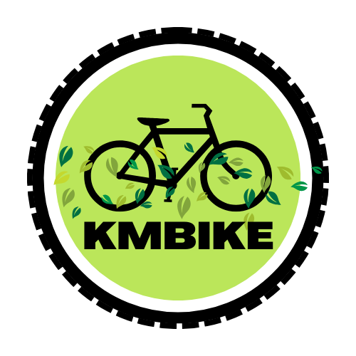

# 🚴‍♀️ KMBIKE

<p align="center">
  
</p>

<p align="center">
  <strong>Plataforma web para la promoción del ciclismo urbano y monitoreo en tiempo real de estaciones de bicicletas compartidas en Colombia.</strong>
</p>

<p align="center">
  
  
  
  
  
  
</p>

---

## 📖 Tabla de Contenidos

- [Descripción General](#-descripción-general)
- [Características Principales](#-características-principales)
- [Rutas de la Aplicación](#-rutas-de-la-aplicación)
- [Stack Tecnológico](#-stack-tecnológico)
- [Estructura del Proyecto](#-estructura-del-proyecto)
- [Integración con APIs Externas](#-integración-con-apis-externas)
- [Instalación y Configuración](#-instalación-y-configuración)
- [Scripts Disponibles](#-scripts-disponibles)
- [Despliegue](#-despliegue)
- [Autores y Créditos](#-autores-y-créditos)

---

## 🌍 Descripción General

**KMBIKE** es una aplicación web SPA (*Single Page Application*) desarrollada en **React** diseñada para fomentar la movilidad sostenible y el uso cotidiano de la bicicleta.

El proyecto centraliza dos pilares clave:
1. **Monitoreo en tiempo real de sistemas de bicicletas públicas**: Consulta el estado, disponibilidad de bicicletas mecánicas/eléctricas y puestos de anclaje libres en las redes de **Bogotá (Tembici)** y **Medellín (EnCicla)**.
2. **Cultura ciclista y catálogo de referencia**: Consejos de seguridad vial urbana, categorización de bicicletas por modalidad (Ruta, MTB, Gravel) y catálogo de modelos deportivos destacados.

---

## ✨ Características Principales

- 🚲 **Disponibilidad en Vivo**: Consulta en tiempo real de estaciones mediante la API abierta de *CityBikes*.
- 🔍 **Filtros Interactivos**: Selección rápida por ciudad (Bogotá o Medellín) y búsqueda por estación individual.
- 📍 **Integración con Google Maps**: Enlace directo en cada tarjeta de estación para abrir la ubicación satelital exacta.
- 🖼️ **Carrusel Promocional**: Banner rotativo con transiciones automáticas y controles manuales de navegación.
- 🚴 **Guía de Modalidades**: Exploración visual de disciplinas ciclistas (Ruta, Mountain Bike y Gravel).
- 💡 **Educación y Seguridad Vial**: Consejos prácticos sobre visibilidad nocturna, velocidad adecuada y conducción defensiva.
- 📱 **Diseño 100% Responsivo**: Interfaz moderna adaptable a dispositivos móviles, tablets y escritorios con menú de navegación colapsable.
- 🚦 **Manejo de Rutas 404**: Página de error personalizada cuando se intenta acceder a rutas no definidas.

---

## 🧭 Rutas de la Aplicación

| Ruta | Componente | Descripción |
| :--- | :--- | :--- |
| `/` | `Home` | Página de inicio: Carrusel de bienvenida, modelos destacados, categorías y consejos viales. |
| `/bicicletas` | `Bicicletas` | Buscador de estaciones públicas en Bogotá y Medellín con métricas en tiempo real. |
| `/about` | `About` | Información institucional, misión, visión y valores de KMBIKE. |
| `*` | `NotFound` | Vista de error personalizada 404 para URLs no encontradas. |

---

## 💻 Stack Tecnológico

- **Core**: [React 18](https://react.js.org/)
- **Enrutamiento**: [React Router v7](https://reactrouter.com/)
- **Peticiones HTTP**: Fetch API y [Axios](https://axios-http.com/)
- **Estilos**: CSS3 modular desacoplado por vistas y componentes
- **Empaquetador**: [Create React App (react-scripts)](https://create-react-app.dev/)
- **Despliegue**: [Netlify](https://www.netlify.com/) con reglas de redirección SPA

---

## 📂 Estructura del Proyecto

```text
kmbike/
├── public/                     # Archivos estáticos públicos
│   ├── favicon.ico
│   ├── index.html              # Plantilla HTML principal
│   ├── manifest.json
│   └── robots.txt
├── src/
│   ├── assets/                 # Imágenes, logos y fotografías de productos
│   ├── components/             # Componentes reutilizables de la UI
│   │   ├── CategoriesSection.js# Sección de categorías (Ruta, MTB, Gravel)
│   │   ├── Footer.js           # Pie de página y enlaces institucionales
│   │   ├── Header.js           # Barra de navegación principal y menú móvil
│   │   ├── Home.js             # Composición de la vista de inicio
│   │   ├── NewsSection.js      # Consejos y tips de ciclismo urbano
│   │   ├── NotFound.js         # Vista 404 Not Found
│   │   ├── ProductsSection.js  # Catálogo de bicicletas destacadas
│   │   └── PromoBanner.js      # Carrusel de imágenes
│   ├── pages/                  # Vistas completas de la aplicación
│   │   └── About.js            # Página "Acerca de Nosotras"
│   ├── styles/                 # Hojas de estilo CSS por componente
│   ├── App.css                 # Estilos globales de la app
│   ├── App.js                  # Configuración de rutas y lógica de Bicicletas
│   ├── index.css               # Estilos base y reset de CSS
│   ├── index.js                # Punto de entrada de React (createRoot)
│   └── netlify.toml            # Reglas de redirección para despliegue en Netlify
├── package.json                # Dependencias y scripts del proyecto
└── README.md                   # Documentación del proyecto
```

---

## 🌐 Integración con APIs Externas

La aplicación consume los endpoints abiertos de **[CityBikes API](https://api.citybik.es/)** para consultar en paralelo la información de las redes de bicicletas públicas:

| Ciudad | Red / Operador | Endpoint API |
| :--- | :--- | :--- |
| **Bogotá** | Tembici Bogotá | `https://api.citybik.es/v2/networks/tembici-bogota` |
| **Medellín**| EnCicla | `https://api.citybik.es/v2/networks/encicla` |

### Métricas procesadas por estación:
- Nombre y código identificador de la estación.
- Coordenadas geográficas (`latitude`, `longitude`).
- Bicicletas libres disponibles (`free_bikes`).
- Puestos de anclaje libres disponibles (`empty_slots`).

---

## 🚀 Instalación y Configuración

### Prerrequisitos
- [Node.js](https://nodejs.org/) (versión 16.x, 18.x o superior recomendada)
- [npm](https://www.npmjs.com/) (incluido con Node.js) o [yarn](https://yarnpkg.com/)
- [Git](https://git-scm.com/)

### Pasos para ejecutar en local

1. **Clonar el repositorio:**
   ```bash
   git clone https://github.com/T4ti4n4/kmbike.git
   cd kmbike
   ```

2. **Instalar dependencias:**
   ```bash
   npm install
   ```

3. **Iniciar el servidor de desarrollo:**
   ```bash
   npm start
   ```

4. **Abrir en el navegador:**
   Ingresa a [http://localhost:3000](http://localhost:3000) para ver la aplicación funcionando.

---

## 🛠️ Scripts Disponibles

En el directorio del proyecto puedes ejecutar:

- `npm start`: Inicia la aplicación en modo de desarrollo con recarga en caliente (*hot-reloading*).
- `npm run build`: Compila y empaqueta la aplicación lista para producción en la carpeta `build/`. Optimiza y minifica los archivos para máximo rendimiento.
- `npm test`: Ejecuta los tests configurados en modo observador interactivo (*interactive watch mode*).
- `npm run eject`: **Atención**: Operación irreversible para personalizar manualmente la configuración de Webpack, Babel y ESLint.

---

## ☁️ Despliegue

La aplicación está lista para ser desplegada en plataformas de hosting estático como **Netlify**, **Vercel** o **GitHub Pages**.

### Despliegue en Netlify
El proyecto incluye un archivo `netlify.toml` con la regla de redirección necesaria para que las rutas manejadas por `react-router-dom` funcionen correctamente sin arrojar errores 404 al recargar:

```toml
[[redirects]]
  from = "/*"
  to = "/index.html"
  status = 200
```

> **Nota**: Para que Netlify reconozca el archivo automáticamente en la raíz durante el build, se recomienda ubicar `netlify.toml` en la raíz del repositorio o colocar un archivo `_redirects` dentro de la carpeta `public/`.

---

## 👥 Autores y Créditos

Proyecto desarrollado con ❤️ por 
T4ti4n4
DaliaCab
pannzzz
